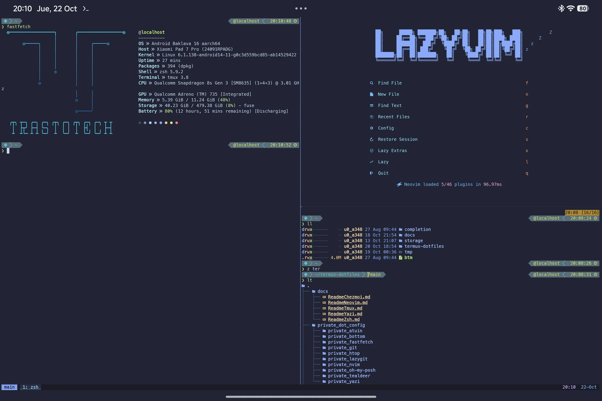
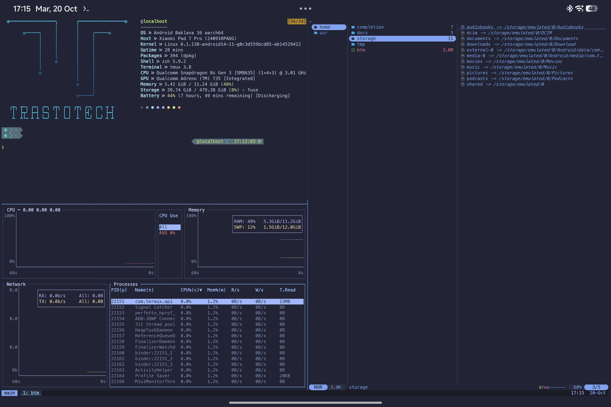

# Termux Dotfiles for Android Tablets

Automated development environment and configuration management for Termux on Android (aarch64), managed via [chezmoi](https://www.chezmoi.io/).

Optimized for mobile productivity with hardware keyboards, trackpads, and touch input, featuring consistent Tokyo Night styling across all tools.

---

## Overview





---

## Quick Start

To provision this complete environment on a clean Termux installation, run:

```bash
pkg install -y git chezmoi
chezmoi init --apply TrastoRacing/Termux-dotfiles
```

The automated provisioning scripts will:

1. Install all native Termux packages and command-line utilities.
2. Install global Node.js language servers, formatters, and linters.
3. Configure Zsh as the default login shell.
4. Set up the MesloLGS Nerd Font and Tokyo Night terminal color scheme.
5. Clone and wire essential Zsh plugins (`zsh-autosuggestions`, `zsh-syntax-highlighting`).
6. Download the official `bottom` (`btm`) monitoring binary for Android aarch64.
7. Generate a local encryption key for Atuin command history.
8. Initialize and restore LazyVim plugins according to the lockfile.

### Post-Installation Setup

Because this repository strictly enforces a zero-secrets baseline, personal Git identity attributes are omitted. After initialization, configure your personal Git commit credentials in `~/.gitconfig` (keeping your identity separate from the tracked chezmoi configuration in `~/.config/git/config`):

```bash
git config --file ~/.gitconfig user.name "Your Name"
git config --file ~/.gitconfig user.email "your.email@example.com"
```

---

## Architectural Components

| Tool | Role | Configuration Highlights |
| :--- | :--- | :--- |
| **Zsh & Oh My Posh** | Interactive Shell | Powerlevel10k Classic prompt, history sharing, directory hashing, and fast completion. |
| **Tmux** | Terminal Multiplexer | Session persistence against Android process suspension, hardware keyboard splits, and trackpad support. |
| **Neovim & LazyVim** | Code Editor / IDE | Tokyo Night Moon palette, full LSP suite, auto-formatting, auto-save, and Lazygit integration. |
| **Yazi** | File Manager | Asynchronous TUI file manager with image, PDF, and video previews, plus Android clipboard sync. |
| **Mise** | Polyglot Runtime Manager | High-performance Rust manager replacing `nvm`/`pyenv`/`asdf` for instant project-level toolchain switching. |
| **Modern CLI Stack** | Productivity Utilities | `fzf`, `fd`, `ripgrep`, `bat`, `eza`, `zoxide`, `bottom`, `atuin`, `duf`, `tealdeer`, and `lazygit`. |

---

## Hardware Keyboard and Tablet Ergonomics

Standard desktop dotfiles frequently run into compatibility limitations on Android tablets due to OS-level interception of modifier keys like `AltGr`. This configuration addresses those pain points:

- **Keyboard Splits in Tmux:** Primary vertical splits are bound to `Ctrl + a` followed by `v`, and horizontal splits to `Ctrl + a` followed by `s` or `-`, eliminating reliance on fragile `AltGr` symbol keys.
- **Direct Pane Navigation:** Move between splits without pressing a prefix key using `Alt + Arrow keys`.
- **Trackpad and Mouse Integration:** Global mouse mode is active (`set -g mouse on`), allowing single-tap pane focusing, border dragging to resize splits, and two-finger scrolling for history buffers.
- **Native Android Clipboard Bridge:** Seamless interoperability with Android system clipboards via `termux-clipboard-set` and `termux-open`. Holding `Shift` bypasses terminal mouse capture for native text selection.

---

## Detailed Documentation

Comprehensive reference guides for individual applications are available in the `docs/` directory:

- [Tmux Guide](docs/ReadmeTmux.md): Session management, splits, and pointer controls.
- [Yazi Guide](docs/ReadmeYazi.md): Navigation, file manipulation, and preview engine integrations.
- [Zsh Terminal Guide](docs/ReadmeZsh.md): Interactive search, aliases, and command cheat sheets.
- [Neovim & LazyVim Guide](docs/ReadmeNeovim.md): Modal editing, leader shortcuts, and LSP diagnostics.
- [Chezmoi Guide](docs/ReadmeChezmoi.md): Workflow operations, dotfile maintenance, and zero-secrets architecture.

---

## Security Policy

This repository adheres to a strict zero-secrets policy:

- No SSH keys, GPG keys, or personal credentials are included.
- No Git credentials, GitHub tokens, or email addresses are tracked.
- Shell histories, machine caches, and runtime databases are excluded via `.gitignore` and `.chezmoiignore`.
- Sensitive dotfile targets are deployed with restricted permissions (`0600`/`0700`).

---

## License and Attribution

- The dotfiles, configurations, and provisioning scripts in this repository are licensed under the [MIT License](LICENSE).
- The bundled terminal font **MesloLGS NF** (`private_dot_termux/private_font.ttf`) is created by André Berg and customized by Roman Perepelitsa, licensed under the [Apache License 2.0](private_dot_termux/private_readonly_LICENSE-font.txt).
